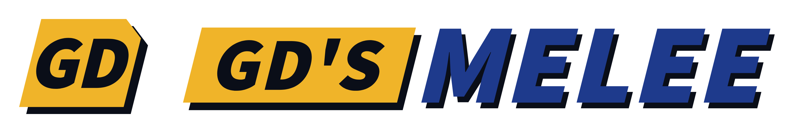

# GD's Melee workspace

  <picture>
    <source media="(prefers-color-scheme: dark)" srcset="docs/readme/brand/logo_horizontal_dark.png">
    <source media="(prefers-color-scheme: light)" srcset="docs/readme/brand/logo_horizontal_light.png">
    
  </picture>

  
  

> **The engine has moved.** GD's Melee is now a native **Rust** engine on the
> [`rust-port` branch of GurekamDhillon/melee](https://github.com/GurekamDhillon/melee/tree/rust-port).
> Start there for status, build steps and docs.

This repo is the workspace around the engine: the launcher, release packaging, test and benchmark tooling,
and research notes. It holds no game data; every tool expects a disc image you made from your own disc.

## What is here

| Folder | What |
|---|---|
| `tools/` | release packaging, test harnesses, benchmark scripts |
| `menu/` | the launcher |
| `ports/` | fighter-port research and IR |
| `docs/` | workspace docs and the README brand images |
| `_research/` | notes from earlier work |

## Releases

The [releases page](https://github.com/GurekamDhillon/gd-melee-workspace/releases) holds the 0.2 and 0.3 builds of
the earlier **C** port (`pc-port`). They still work but are no longer developed; the C build only gets upstream
syncs and shared-bug fixes. New builds come from the Rust engine.

## Licence and legal

GPL-2.0-or-later ([LICENSE](LICENSE)); third-party parts keep their own licences ([CREDITS.md](CREDITS.md),
[DEPENDENCIES.md](DEPENDENCIES.md)). Not affiliated with or endorsed by Nintendo. No Nintendo code, assets or
disc data are included: bring your own disc.
